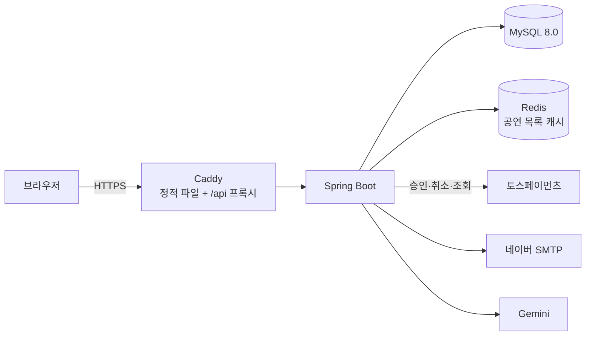
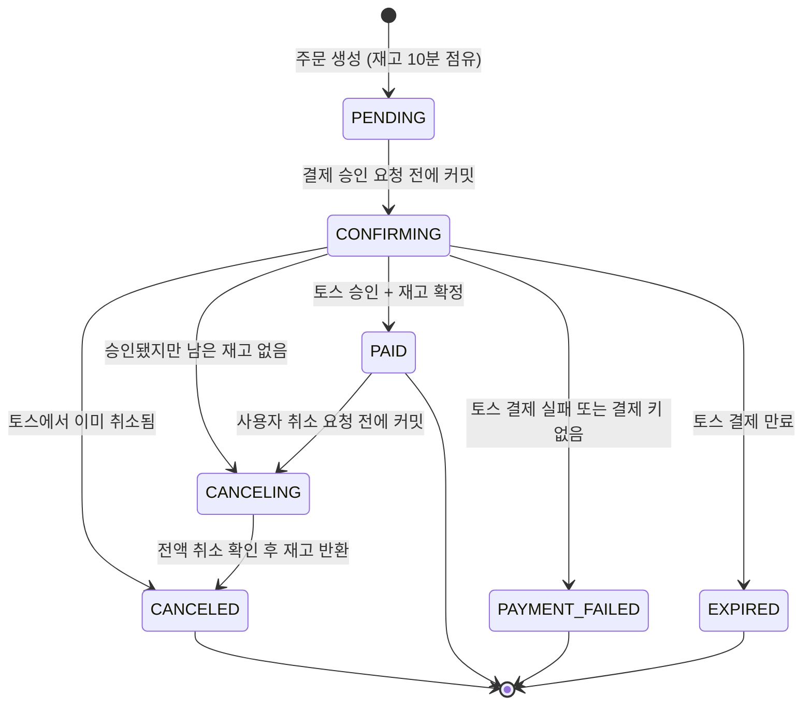

# Free Ticket

공연·전시 티켓 예매 서비스. 공연을 고르고 좌석 등급과 수량을 선택해 토스페이먼츠로 결제·취소한다.

[](https://github.com/wamddu/Free_Ticket/actions/workflows/ci.yml)

**배포:** https://13-209-194-94.sslip.io (토스 테스트 모드, 실제 결제되지 않음)

| 체험 계정 | 이메일 | 비밀번호 | 할 수 있는 것 |
|---|---|---|---|
| 사용자 | `user@example.com` | `password123!` | 공연 조회, 예매, 테스트 결제·취소 |
| 관리자 | `admin@example.com` | `password123!` | 관리자 화면 조회 (수정 불가, 회원 개인정보는 가려서 표시) |

체험 계정은 누구나 쓰는 공개 계정이라 비밀번호 변경·탈퇴와 관리자 데이터 수정이 막혀 있다. 결제는 토스 테스트 모드라 실제로 돈이 나가지 않는다.

## 프로젝트 정보

- **기간:** 2026.05 ~ (4인 팀)
- **담당:** 백엔드 전반
- **2026.11 개선:** 장애 대응 보강, CI 구축, Flyway 도입, 체험 계정 보호, 문서화 ([개선 내역](#개선-내역-202611))

## 기술 스택

| 영역 | 사용 기술 |
|---|---|
| Backend | Java 21, Spring Boot 4.1, Spring Security, Spring Data JPA (Hibernate 7), JJWT(JWT 발급·검증 라이브러리) |
| DB · 캐시 | MySQL 8.0, Flyway, Redis |
| 외부 연동 | 토스페이먼츠(결제·취소·거래 조회), 네이버 SMTP(메일 인증), Gemini(AI 공연 검색), 네이버 지도 |
| Frontend | React 19, TypeScript, Vite, Tailwind CSS, Vitest |
| 인프라 | AWS EC2, Docker Compose, Caddy(HTTPS·리버스 프록시), GitHub Actions |

## 구성



## 주요 기능

- **회원:** 이메일 인증 회원가입, 비밀번호 재설정. Access 토큰과 HttpOnly 쿠키의 Refresh 토큰을 함께 쓴다. Refresh 토큰은 쓸 때마다 새로 발급하고, 이미 쓴 토큰이 다시 오면 그 로그인 전체를 끊는다.
- **공연:** 카테고리별 목록, 검색, 인기 공연(WHAT'S HOT), 최근 7일 판매 기준 주간 랭킹, AI 공연 검색
- **예매·결제:** 주문 생성 시 10분간 재고 점유, 토스 결제 승인, 예매 취소(전액 환불)
- **관리자:** 테이블 데이터 관리, 토스 거래 내역과 DB 상태가 다른 결제를 찾아 처리하는 결제 대사 화면

## 결제 상태

외부 결제(토스)를 호출하기 **전에** 상태를 먼저 커밋한다. 그래서 호출 도중 서버가 죽거나 응답이 사라져도, DB에 남은 상태와 결제 키로 복구 스케줄러가 결과를 확정할 수 있다.



- `CONFIRMING`과 `CANCELING`은 "외부 결과를 아직 모르는 상태"다. 복구 스케줄러가 30초마다 대상 주문을 찾아(같은 주문은 2분 간격) 토스에 조회해 확정하고, 20회까지 확정하지 못하면 관리자 확인 대상으로 표시한다.
- 승인·취소 요청에는 주문마다 고정된 멱등 키를 보낸다. 재시도해도 토스에서 두 번 승인되거나 두 번 취소되지 않는다.
- `PENDING` 주문은 결제 기한(10분)이 지나면 상태는 그대로 두고 재고 점유만 풀린다.

## 장애 시나리오와 대응

| 상황 | 대응 | 검증 테스트 |
|---|---|---|
| 토스 승인 응답을 받기 전에 연결이 끊김 | `CONFIRMING`으로 남기고 503 응답. 스케줄러가 토스 조회로 승인·실패를 확정 | `PaymentRecoveryIntegrationTest.approvalResponseLossLeavesDurableRecoveryInformation` |
| 토스는 승인했는데 DB 커밋이 실패 | 저장된 결제 키로 다시 조회해 결제 완료로 복구 | `PaymentCommitFailureIntegrationTest.shouldRecoverApprovedPaymentWhenFirstCommitRollsBack` |
| 승인 직후 재고가 없음 | `CANCELING`을 먼저 커밋한 뒤 토스 취소(보상 트랜잭션) | `PaymentRecoveryIntegrationTest.confirmedShortageCommitsCancelingBeforeExternalCancel` |
| 서버 재시작 후 미완료 결제 | DB에 커밋된 정보만으로 새 인스턴스가 이어서 처리 | `PaymentRecoverySchedulerIntegrationTest.newServiceInstanceRecoversUsingOnlyCommittedData` |
| 스케줄러 두 개가 같은 주문을 처리 | 행 잠금과 다음 시도 시각 선점으로 한 곳만 처리 | `PaymentRecoverySchedulerIntegrationTest.twoWorkersDoNotClaimTheSameDueOrder` |
| 원래 승인 요청과 복구가 겹침 | 재고를 한 번만 차감 | `PaymentRecoverySchedulerIntegrationTest.originalApprovalAndRecoveryDoNotDoubleSell` |
| 취소 응답 유실 | 같은 취소 멱등 키로 재시도하고 조회로 확정 | `ReservationCancellationIntegrationTest.lostProviderResponseIsRecoveredFromCommittedCancellationIntent` |
| 같은 예매를 동시에 두 번 취소 | 재고를 한 번만 반환 | `ReservationCancellationIntegrationTest.concurrentRequestsCannotRestoreInventoryTwice` |
| 마지막 1장에 100명이 동시 주문 (MySQL) | 티켓 행 비관적 잠금으로 1명만 성공 | `LastTicketConcurrencyTest.oneRemainingTicketVsOneHundredBuyers` |
| 존재하지 않는 결제 키로 재고를 계속 점유 | 3회 이상 조회해도 없고 기한+10분이 지나면 결제 실패로 확정해 재고 해제 | `InventoryHoldIntegrationTest.unknownPaymentKeyIsFailedAfterGraceAndReleasesTheTicket` |
| 한 사용자가 재고를 대량 점유 | 티켓당 미결제 점유 10장 제한 | `InventoryHoldIntegrationTest.oneUserCannotHoldMoreThanTenOfATicket` |
| 토스 쪽에서만 취소·부분 취소된 거래 | 거래 내역을 주기적으로 대조(설정으로 켬)해 불일치로 기록하고 관리자가 처리 | `PaymentReconciliationIntegrationTest.cancellationAndTwoPartialTransactionsAreRecordedOnceWithoutChangingBooking` |
| 처리하지 못한 예외 | 빈 403 대신 일관된 JSON 오류(400/404/405/500) 응답 | `ErrorResponseIntegrationTest` |

## 성능 측정과 개선

측정 → 병목 확인 → 개선 → 재측정 순서로 진행했다. 데이터는 공연 96·500·1,000개 세 규모, 도구는 Java 부하 생성기와 k6를 썼다. 서버 쪽은 JMX(스레드·DB 연결), MySQL `performance_schema`(SQL 실행 횟수·시간), TCP 카운터를 함께 기록했다.

| 단계 | 확인한 것 | 한 일 | 결과 |
|---|---|---|---|
| 1. HOT API 단독 측정 | 공연 수가 96→1,000개로 늘면 p95가 119→641ms로 증가 | 순위 계산에는 ID·종료일·판매량만 쓰고, 상위 N개를 고른 뒤 상세 정보를 읽도록 쿼리 변경 | 같은 조건에서 번갈아 3회씩 측정한 중앙값 기준 p95 −14%, 처리량 575→870 req/s(+51%). 결과가 바이트 단위로 같은지 확인 |
| 2. 단계별 부하 | 1,500 req/s에서 작업 스레드 200/200 포화, DB 연결 10개를 최대 190개 요청이 기다림. 같은 결과를 요청마다 다시 계산 | HOT 응답 5초 캐시. 만료 순간 동시에 들어온 요청도 한 번만 계산 | 1,000 req/s×10초에서 HOT SQL 실행 9,974→2회, DB 연결 대기 190→0. 1,500 req/s 성공률 82%→100% |
| 3. 연결 실패 원인 분리 | 실패는 SQL 오류가 아니라 연결 시간 초과. keep-alive 연결이 슬롯 8,192개를 점유하고 TCP 접속 대기열(100)이 넘침 | 설정을 하나씩 바꾸는 비교(최대 연결 수, 접속 대기열, keep-alive)와 CPU·DB 부하 없는 재현 시험 | 접속 대기열을 100→2,048로 늘린 경우만 대기열 넘침이 크게 줄었다(4,403→0회, 생성기 4대 동시 시험 6,355→1,049회). 최대 연결 수 상향은 효과가 없었고 keep-alive 단축은 악화. 아직 운영 설정에는 반영하지 않았다 |
| 4. EC2 배포 서버 측정 | 1만 요청/1초 시험에서 부하 생성기 PC의 로컬 포트가 먼저 고갈 | 생성기 쪽 한계(포트 충돌, 실제 발송 시간)를 결과와 분리해 기록 | "1만 명/1초 처리"는 이 장비로 검증할 수 없다고 판단하고 주장하지 않음 |
| 5. 화면 단위 측정 | 장르 화면은 API 4개를 동시에 호출. 같은 부하에서 메인 화면 p95 417ms, 장르 화면 3,634ms. 주간 순위 SQL이 방문마다 실행(누적 41,288회·371초), 목록은 페이지 없이 전체를 내려줌(1,000개 기준 78KB) | 주간 순위의 중복 조회 제거와 캐시, 목록 페이지 나누기(30개, 다음 페이지 유무는 한 행 더 읽어 판단), 목록 Redis 캐시(30초, 캐시 미스 시 한 번만 조회, Redis 장애 시 DB로 대체) | 반영 후 같은 시나리오로 다시 측정하지는 못했다 |

그 밖에 로그인 때마다 실행되던 만료 리프레시 토큰 삭제를 스케줄러로 옮기고 1,000건씩 나눠 지우게 했다. 주간 랭킹 조회용 `orders (status, paid_at)` 인덱스도 추가했다.

**한계:** 부하 생성기와 서버가 같은 PC에 있거나(로컬), 생성기 PC 한 대에서 보낸(EC2) 측정이다. 그래서 응답 시간의 절대값보다 **SQL 실행 횟수, DB 연결 대기 같은 서버 작업량의 변화**를 개선 근거로 삼았다. 자세한 조건과 수치: [HOT API 보고서](docs/reports/2026-09-24-hot-api-performance.md), [화면 단위 보고서](docs/reports/2026-09-25-page-api-performance.md)

## 테스트와 CI

- 백엔드 테스트 365개. H2 단위·통합 테스트에 더해 **MySQL 8.0 컨테이너에서** 동시성 테스트와 마이그레이션 검증을 실행한다.
- GitHub Actions가 main 푸시와 PR마다 백엔드 테스트와 프론트 린트·테스트·빌드를 실행한다.
- `FlywayMigrationTest`가 빈 MySQL에 모든 마이그레이션을 적용한 뒤, 엔티티와 테이블이 일치하는지 검사한다.

## 개선 내역 (2026.11)

포트폴리오로 정리하며 점검하다가 발견한 문제를, 재현 테스트를 먼저 작성한 뒤 고쳤다.

- **오류 응답:** 처리하지 못한 예외가 `/error`로 넘어가며 인증 정보가 사라져 빈 403이 응답되던 문제를 고쳤다. 이제 상태별로 일관된 JSON 오류를 돌려준다.
- **재고 점유 악용:** 가짜 결제 키로 주문을 만들어 재고를 무기한 묶을 수 있던 문제를 고쳤다. 토스 조회 결과를 근거로 결제 실패를 확정하고, 1인당 점유 수량을 제한했다.
- **비밀번호 정책:** 비밀번호 변경 API에 검증이 없어 1자 비밀번호로도 바꿀 수 있었고, 가입 때 72바이트를 넘으면 BCrypt 예외가 났다. 규칙을 한 곳으로 모아 가입·변경·재설정에 같이 적용했다.
- **주간 랭킹:** 누적 판매량으로 집계하던 것을 최근 7일 결제 수량 기준으로 바꿨다. 최근 판매가 없으면 누적 순위로 대신 보여 주고, 화면에 그 사실을 표시한다.
- **CI 구축**과 **Flyway 도입:** 운영 DB는 구조 비교 → baseline으로 데이터 변경 없이 전환했다.
- **공개 체험 계정 보호**와 **로컬 데모 데이터:** 데모 데이터는 실행일 기준 날짜로 만든다.

## 로컬 실행

필요: Docker, JDK 21, Node.js 22

```sh
# 1) 백엔드 + MySQL + Redis (데모 공연과 체험 계정이 함께 생성됨)
cd code/backend
cp .env.example .env        # JWT_SECRET에 openssl rand -hex 32 값, 토스 테스트 시크릿 키 입력
docker compose up -d --build

# 2) 프론트엔드
cd ../frontend
cp .env.example .env        # 토스 테스트 클라이언트 키, 네이버 지도 클라이언트 ID 입력
npm ci
npm run dev                 # http://localhost:5173
```

테스트: `cd code/backend && ./gradlew test` (MySQL 테스트는 `RUN_MYSQL_CONCURRENCY=true`와 3308 포트 MySQL이 필요하며, CI 설정 [ci.yml](.github/workflows/ci.yml)과 같다)

## 문서

- [데이터베이스 설계](docs/database.md): ERD, 제약 조건, 동시성, 스키마 변경 방법
- [배포](docs/deploy.md): EC2 배포·재배포·복구
- 보고서: [HOT API 성능 측정](docs/reports/2026-09-24-hot-api-performance.md), [화면 단위 성능 측정](docs/reports/2026-09-25-page-api-performance.md), [결제 대사 실연동 검증](docs/reports/2026-09-28-payment-reconciliation-toss-test.md), [관리자 결제 처리](docs/reports/2026-09-29-admin-payment-operations.md)
