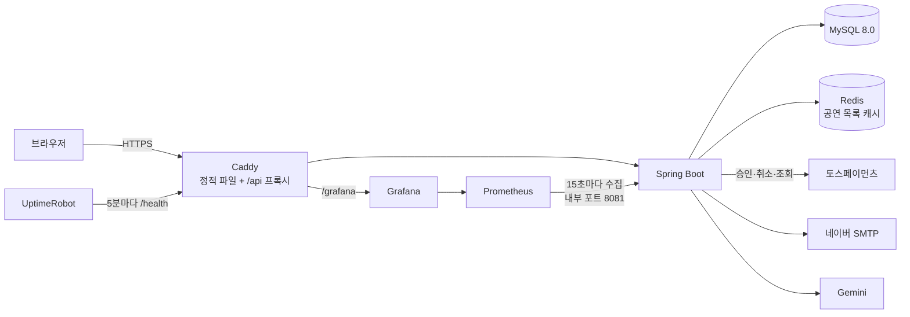
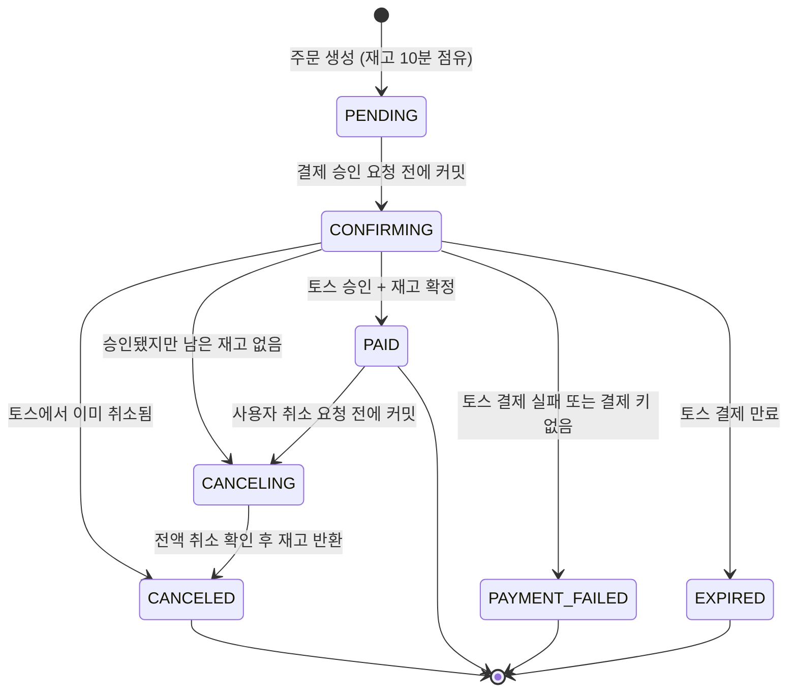

# Free Ticket

공연·전시 티켓 예매 서비스. 공연을 고르고 좌석 등급과 수량을 선택해 토스페이먼츠로 결제·취소한다.

[](https://github.com/wamddu/Free_Ticket/actions/workflows/ci.yml)

**배포:** https://13-209-194-94.sslip.io (토스 테스트 모드, 실제 결제되지 않음)

**운영 모니터링:** [Grafana 대시보드](https://13-209-194-94.sslip.io/grafana/d/free-ticket) (로그인 없이 보기만 가능) · [상태 확인](https://13-209-194-94.sslip.io/health)

| 체험 계정 | 이메일 | 비밀번호 | 할 수 있는 것 |
|---|---|---|---|
| 사용자 | `user@example.com` | `password123!` | 공연 조회, 예매, 테스트 결제·취소 |
| 관리자 | `admin@example.com` | `password123!` | 관리자 화면 조회 (수정 불가, 회원 개인정보는 가려서 표시) |

체험 계정은 누구나 쓰는 공개 계정이라 비밀번호 변경·탈퇴와 관리자 데이터 수정이 막혀 있다. 결제는 토스 테스트 모드라 실제로 돈이 나가지 않는다.

화면: [메인](docs/images/screen-home.jpg) · [공연 상세](docs/images/screen-ticket.jpg) · [랭킹](docs/images/screen-ranking.jpg) · [관리자 결제 처리](docs/images/admin-reconciliation-full-cancel.png) · [관리자 주문 조회](docs/images/admin-orders-read-only.png)

## 프로젝트 정보

- **기간:** 2026.05 ~ (4인 팀)
- **담당:** 백엔드 전반
- **2026.11 개선:** 장애 대응 보강, CI 구축, Flyway 도입, 체험 계정 보호, 모니터링, 문서화 ([개선 내역](#개선-내역-202611))

## 기술 스택

| 영역 | 사용 기술 |
|---|---|
| Backend | Java 21, Spring Boot 4.1, Spring Security, Spring Data JPA (Hibernate 7), JJWT(JWT 발급·검증 라이브러리) |
| DB · 캐시 | MySQL 8.0, Flyway, Redis |
| 외부 연동 | 토스페이먼츠(결제·취소·거래 조회), 네이버 SMTP(메일 인증), Gemini(AI 공연 검색), 네이버 지도 |
| Frontend | React 19, TypeScript, Vite, Tailwind CSS, Vitest |
| 인프라 | AWS EC2, Docker Compose, Caddy(HTTPS·리버스 프록시), GitHub Actions |
| 모니터링 | Spring Boot Actuator, Micrometer, Prometheus, Grafana, UptimeRobot(외부 감시) |

## 구성



## 주요 기능

- **회원:** 이메일 인증 회원가입, 비밀번호 재설정. Access 토큰과 HttpOnly 쿠키의 Refresh 토큰을 함께 쓴다. Refresh 토큰은 쓸 때마다 새로 발급하고, 이미 쓴 토큰이 다시 오면 그 로그인 전체를 끊는다.
- **공연:** 카테고리별 목록, 검색, 인기 공연(WHAT'S HOT), 최근 7일 판매 기준 주간 랭킹, AI 공연 검색
- **예매·결제:** 주문 생성 시 10분간 재고 점유, 토스 결제 승인, 예매 취소(전액 환불)
- **관리자:** 테이블 데이터 관리, 토스 거래 내역과 DB 상태가 다른 결제를 찾아 처리하는 결제 대사 화면

## 결제 상태

외부 결제(토스)를 호출하기 **전에** 상태를 먼저 커밋한다. 그래서 호출 도중 서버가 죽거나 응답이 사라져도, DB에 남은 상태와 결제 키로 복구 스케줄러가 결과를 확정할 수 있다.



- `CONFIRMING`과 `CANCELING`은 "외부 결과를 아직 모르는 상태"다. 복구 스케줄러가 30초마다 대상 주문을 찾아(같은 주문은 2분 간격) 토스에 조회해 확정하고, 20회까지 확정하지 못하면 관리자 확인 대상으로 표시한다.
- 승인·취소 요청에는 주문마다 고정된 멱등 키를 보낸다. 재시도해도 토스에서 두 번 승인되거나 두 번 취소되지 않는다.
- `PENDING` 주문은 결제 기한(10분)이 지나면 상태는 그대로 두고 재고 점유만 풀린다.

## 장애 시나리오와 대응

| 상황 | 대응 | 검증 테스트 |
|---|---|---|
| 토스 승인 응답을 받기 전에 연결이 끊김 | `CONFIRMING`으로 남기고 503 응답. 스케줄러가 토스 조회로 승인·실패를 확정 | `PaymentRecoveryIntegrationTest.approvalResponseLossLeavesDurableRecoveryInformation` |
| 토스는 승인했는데 DB 커밋이 실패 | 저장된 결제 키로 다시 조회해 결제 완료로 복구 | `PaymentCommitFailureIntegrationTest.shouldRecoverApprovedPaymentWhenFirstCommitRollsBack` |
| 승인 직후 재고가 없음 | `CANCELING`을 먼저 커밋한 뒤 토스 취소(보상 트랜잭션) | `PaymentRecoveryIntegrationTest.confirmedShortageCommitsCancelingBeforeExternalCancel` |
| 서버 재시작 후 미완료 결제 | DB에 커밋된 정보만으로 새 인스턴스가 이어서 처리 | `PaymentRecoverySchedulerIntegrationTest.newServiceInstanceRecoversUsingOnlyCommittedData` |
| 스케줄러 두 개가 같은 주문을 처리 | 행 잠금과 다음 시도 시각 선점으로 한 곳만 처리 | `PaymentRecoverySchedulerIntegrationTest.twoWorkersDoNotClaimTheSameDueOrder` |
| 원래 승인 요청과 복구가 겹침 | 재고를 한 번만 차감 | `PaymentRecoverySchedulerIntegrationTest.originalApprovalAndRecoveryDoNotDoubleSell` |
| 취소 응답 유실 | 같은 취소 멱등 키로 재시도하고 조회로 확정 | `ReservationCancellationIntegrationTest.lostProviderResponseIsRecoveredFromCommittedCancellationIntent` |
| 같은 예매를 동시에 두 번 취소 | 재고를 한 번만 반환 | `ReservationCancellationIntegrationTest.concurrentRequestsCannotRestoreInventoryTwice` |
| 마지막 1장에 100명이 동시 주문 (MySQL) | 잠금이 있었는데도 100건이 생성되던 버그를 고침. 잠금 전 일반 조회가 REPEATABLE READ의 읽기 시점을 고정해 이전 데이터로 수량을 계산했으므로, 티켓 잠금을 트랜잭션의 첫 조회로 옮김 → 1건만 성공 ([기록](docs/reports/2026-09-25-last-ticket-concurrency.md)) | `LastTicketConcurrencyTest.oneRemainingTicketVsOneHundredBuyers` |
| 존재하지 않는 결제 키로 재고를 계속 점유 | 3회 이상 조회해도 없고 기한+10분이 지나면 결제 실패로 확정해 재고 해제 | `InventoryHoldIntegrationTest.unknownPaymentKeyIsFailedAfterGraceAndReleasesTheTicket` |
| 한 사용자가 재고를 대량 점유 | 티켓당 미결제 점유 10장 제한 | `InventoryHoldIntegrationTest.oneUserCannotHoldMoreThanTenOfATicket` |
| 토스 쪽에서만 취소·부분 취소된 거래 | 거래 내역을 주기적으로 대조(설정으로 켬)해 불일치로 기록하고 관리자가 처리 | `PaymentReconciliationIntegrationTest.cancellationAndTwoPartialTransactionsAreRecordedOnceWithoutChangingBooking` |
| 처리하지 못한 예외 | 빈 403 대신 일관된 JSON 오류(400/404/405/500) 응답 | `ErrorResponseIntegrationTest` |

## 성능 측정과 개선

측정 → 병목 확인 → 개선 → 같은 조건으로 재측정 순서로 진행했다. 서버 쪽은 JMX(스레드·DB 연결), MySQL `performance_schema`(SQL 실행 횟수·시간), 실행 계획, TCP 카운터를 함께 기록했다.

| 시기 | 확인한 것 | 한 일 | 결과 |
|---|---|---|---|
| 9월 | 예매 내역이 예매 건마다 티켓을 다시 조회(N+1) | 불필요한 보완 조회 제거, `IN` 일괄 조회 | 서비스 조회 1+N회 → **최대 2회** ([기록](docs/reports/2026-09-15-reservation-list-n-plus-1.md)) |
| 9월 | 인기 공연(HOT): 공연 96→1,000개에서 p95 119→641ms. 1,500 req/s에서 스레드 200/200 포화, DB 연결 대기 190 | 순위 계산 쿼리 구조 변경, 5초 캐시(만료 순간 동시 요청도 한 번만 계산) | 처리량 +51%, 같은 부하에서 집계 SQL **9,974 → 2회**, DB 대기 **190 → 0** ([기록](docs/reports/2026-09-24-hot-api-performance.md)) |
| 9월 | 집중 요청 실패는 SQL 오류가 아니라 연결 시간 초과 | 설정을 하나씩 바꾸는 비교와 CPU·DB 부하 없는 재현 | keep-alive 연결의 슬롯 점유와 TCP 접속 대기열 넘침을 원인으로 확인 |
| 9월 | 화면 단위로 측정하니 장르 화면이 병목. 주간 순위가 방문마다 집계, 목록은 전체를 반환 | 아래 10~11월 작업으로 이어짐 | ([기록](docs/reports/2026-09-25-page-api-performance.md)) |
| 10월 | 예매 가능 검색이 8초 안에 끝나지 않음. 주문 테이블 전체 스캔, 요청당 1,446만~3,223만 행 읽음 | `orders(ticket_id)` 인덱스 | 예매 가능 검색 성공 **0% → 100%**(동시 50·100명), 주문 생성 p95 **4.9 → 0.8초**(50명) ([기록](docs/reports/2026-10-31-orders-ticket-index.md)) |
| 10월 | 전화번호 중복 확인과 리프레시 토큰 조회에 인덱스가 없음 | 전화번호, 리프레시 토큰 만료 시각·사용자 인덱스 | 전화번호 수정 p95 **5.6 → 2.4초**(100명) ([기록](docs/reports/2026-10-31-auth-indexes.md)) |
| 11월 | 로그인마다 만료 토큰 전체 삭제를 실행해 데드락과 실패 발생 | 삭제를 스케줄러로 분리, 1,000건씩 처리 | 로그인 성공률 90.7% → **100%**, 데드락 로그 사라짐(50명) ([기록](docs/reports/2026-11-01-token-cleanup.md)) |
| 11월 | 로그인이 여전히 느린 원인 | 프로파일링과 조건 분리 | BCrypt 검증이 스레드 CPU 시간의 87.5%. CPU를 4배로 늘리면 p95 3.5배 개선, 연결 풀 확대는 8%. DB 문제가 아님을 확인 ([기록](docs/reports/2026-11-01-login-bottleneck.md)) |
| 11월 | 공연 목록이 3,500개 전체(1.15MB)를 반환 | 30개씩 페이지 나누기 | 응답 **1.15MB → 5KB**, p95 약 70% 감소(반환 개수가 3,500 → 30개로 달라 같은 작업의 속도 비교는 아님) ([기록](docs/reports/2026-11-01-event-list-pagination.md)) |
| 11월 | 같은 목록을 요청마다 DB에서 읽고 JSON으로 만듦 | Redis 캐시 30초(캐시 미스 시 한 번만 조회, Redis 장애 시 DB로 대체) | 동시 500명 성공률 **59% → 100%**, 100명 p95 14.5 → 2.2초 ([기록](docs/reports/2026-11-01-redis-list-cache.md)) |
| 11/14 | 9월 화면 측정과 같은 시나리오로 9월 버전과 현재 버전 비교 | 같은 데이터에서 번갈아 반복 측정 | 1초 1,000명: 순위 SQL **757 → 7회**, 목록 SQL **749 → 0회**, 장르 화면 p95 1,570 → 1,043ms. 20초 1만 명: DB 시간 **40.5 → 1.3초**, API p95 660 → 406ms ([기록](docs/reports/2026-11-14-page-api-remeasure.md)) |

**남은 병목:** 11/14 재측정에서 20초 동안 1만 명이 방문하면 기본 설정으로는 두 버전 모두 화면의 약 20%가 시간 초과로 실패했다. 서버 연결 한도(8,192)만 올리면 둘 다 100% 성공해서, 원인은 코드가 아니라 연결 설정이었다. 운영 설정은 메모리와 스레드 사용량을 함께 확인한 뒤 바꿀 예정이다.

**한계:** 부하 생성기와 서버가 같은 PC를 쓰거나(로컬), 생성기 PC 한 대에서 보낸(EC2) 측정이다. 그래서 응답 시간의 절대값보다 **SQL 실행 횟수, DB 시간, 성공률 같은 서버 쪽 변화**를 개선 근거로 삼았다. 또 측정마다 데이터 규모와 자원 제한(예: 앱·DB 각 0.5 CPU)이 달라서, 서로 다른 행의 수치를 직접 비교하지 않는다.

## 모니터링

- **대시보드:** API 초당 요청·5xx 비율·p95 응답 시간, Tomcat 연결·스레드, DB 커넥션 풀, JVM 힙·GC·CPU, 결제 승인 결과
- **결제 지표:** 복구를 기다리는 결제, 재시도를 다 써서 사람이 봐야 하는 결제, 토스 취소 내역과 DB가 어긋난 미해결 건을 직접 만든 지표로 보여 준다. 위 결제 상태 설계가 운영 중에 잘 돌아가는지 확인하는 용도다.
- **Tomcat 연결 수:** 성능 측정에서 찾은 남은 병목(연결 한도 8,192)을 그래프로 지켜본다.
- **노출 범위:** 메트릭은 관리 포트(8081)에서만 나오고 외부로 프록시하지 않는다. 바깥에는 `UP`/`DOWN`만 알려 주는 `/health`와 보기 전용 Grafana만 연다.
- **외부 감시:** Prometheus는 같은 서버에 있어 서버 전체가 멈추면 알리지 못한다. 그래서 UptimeRobot이 바깥에서 5분마다 `/health`를 확인하고 메일로 알린다.
- 대시보드와 수집 설정은 파일([monitoring](code/backend/monitoring))로 관리해 서버를 새로 띄워도 같은 화면이 나온다.

## 테스트와 CI

- 백엔드 테스트 369개. H2 단위·통합 테스트에 더해 **MySQL 8.0 컨테이너에서** 동시성 테스트와 마이그레이션 검증을 실행한다.
- GitHub Actions가 main 푸시와 PR마다 백엔드 테스트와 프론트 린트·테스트·빌드를 실행한다.
- `FlywayMigrationTest`가 빈 MySQL에 모든 마이그레이션을 적용한 뒤, 엔티티와 테이블이 일치하는지 검사한다.

## 개선 내역 (2026.11)

포트폴리오로 정리하며 점검하다가 발견한 문제를, 재현 테스트를 먼저 작성한 뒤 고쳤다.

- **오류 응답:** 처리하지 못한 예외가 `/error`로 넘어가며 인증 정보가 사라져 빈 403이 응답되던 문제를 고쳤다. 이제 상태별로 일관된 JSON 오류를 돌려준다.
- **재고 점유 악용:** 가짜 결제 키로 주문을 만들어 재고를 무기한 묶을 수 있던 문제를 고쳤다. 토스 조회 결과를 근거로 결제 실패를 확정하고, 1인당 점유 수량을 제한했다.
- **비밀번호 정책:** 비밀번호 변경 API에 검증이 없어 1자 비밀번호로도 바꿀 수 있었고, 가입 때 72바이트를 넘으면 BCrypt 예외가 났다. 규칙을 한 곳으로 모아 가입·변경·재설정에 같이 적용했다.
- **주간 랭킹:** 누적 판매량으로 집계하던 것을 최근 7일 결제 수량 기준으로 바꿨다. 최근 판매가 없으면 누적 순위로 대신 보여 주고, 화면에 그 사실을 표시한다.
- **CI 구축**과 **Flyway 도입:** 운영 DB는 구조 비교 → baseline으로 데이터 변경 없이 전환했다.
- **공개 체험 계정 보호**와 **로컬 데모 데이터:** 데모 데이터는 실행일 기준 날짜로 만든다.
- **모니터링:** Prometheus·Grafana로 API, 서버 자원, 결제 복구 상태를 보고, UptimeRobot으로 바깥에서 서버가 살아 있는지 확인한다.

## 로컬 실행

필요: Docker, JDK 21, Node.js 22

```sh
# 1) 백엔드 + MySQL + Redis (데모 공연과 체험 계정이 함께 생성됨)
cd code/backend
cp .env.example .env        # JWT_SECRET에 openssl rand -hex 32 값, 토스 테스트 시크릿 키 입력
docker compose up -d --build

# 2) 프론트엔드
cd ../frontend
cp .env.example .env        # 토스 테스트 클라이언트 키, 네이버 지도 클라이언트 ID 입력
npm ci
npm run dev                 # http://localhost:5173
```

테스트: `cd code/backend && ./gradlew test` (MySQL 테스트는 `RUN_MYSQL_CONCURRENCY=true`와 3308 포트 MySQL이 필요하며, CI 설정 [ci.yml](.github/workflows/ci.yml)과 같다)

## 문서

- [데이터베이스 설계](docs/database.md): ERD, 제약 조건, 동시성, 스키마 변경 방법
- [배포](docs/deploy.md): EC2 배포·재배포·복구·모니터링
- 장애 대응: [결제 복구 설계](docs/reports/2026-09-19-payment-recovery.md), [복구 스케줄러](docs/reports/2026-09-20-payment-recovery-scheduler.md), [마지막 티켓 동시 주문](docs/reports/2026-09-25-last-ticket-concurrency.md), [결제 대사 실연동 검증](docs/reports/2026-09-28-payment-reconciliation-toss-test.md), [관리자 결제 처리](docs/reports/2026-09-29-admin-payment-operations.md)
- 성능: [예매 내역 N+1](docs/reports/2026-09-15-reservation-list-n-plus-1.md), [HOT API](docs/reports/2026-09-24-hot-api-performance.md), [화면 단위 측정](docs/reports/2026-09-25-page-api-performance.md), [10월 종합 측정](docs/reports/2026-10-31-local-performance-baseline.md), [주문 인덱스](docs/reports/2026-10-31-orders-ticket-index.md), [인증 인덱스](docs/reports/2026-10-31-auth-indexes.md), [로그인 병목](docs/reports/2026-11-01-login-bottleneck.md), [토큰 정리 분리](docs/reports/2026-11-01-token-cleanup.md), [목록 페이지 나누기](docs/reports/2026-11-01-event-list-pagination.md), [Redis 목록 캐시](docs/reports/2026-11-01-redis-list-cache.md), [화면 단위 재측정](docs/reports/2026-11-14-page-api-remeasure.md)
