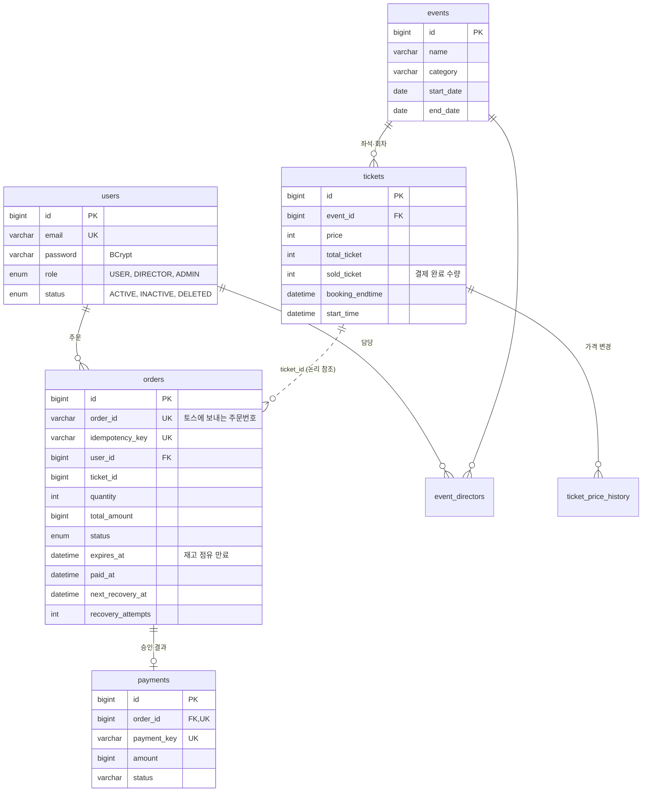

# 데이터베이스 설계

MySQL 8.0 / InnoDB / utf8mb4. 테이블 구조는 [Flyway 마이그레이션](../code/backend/src/main/resources/db/migration)이 유일한 기준이며, 애플리케이션은 `ddl-auto=validate`로 엔티티와 테이블이 일치하는지만 검사한다.

## ERD

예매·결제 흐름의 핵심 테이블이다. 인증 보조 테이블(`email_verifications`, `refresh_tokens`)과 결제 대사 테이블은 아래 표에 따로 정리했다.

## 테이블

| 테이블 | 역할 |
|---|---|
| `users` | 회원. 이메일 UNIQUE, 탈퇴는 `status=DELETED`와 이메일 변경으로 처리(소프트 삭제) |
| `events` / `tickets` | 공연과 회차·좌석 등급별 티켓. `sold_ticket`은 결제가 끝난 수량만 센다 |
| `ticket_price_history` | 티켓 가격 변경 이력(판매자 설정과 자동 가격 조정) |
| `event_directors` | 공연 담당자(판매자)와 공연의 연결 |
| `orders` | 주문과 결제 진행 상태. 결제 복구용 필드(`next_recovery_at`, `recovery_attempts`, `recovery_review_required`)를 함께 둔다 |
| `payments` | 토스 승인 결과. 주문당 하나 |
| `email_verifications` | 이메일 인증·비밀번호 재설정 코드. 코드와 토큰은 해시만 저장 |
| `refresh_tokens` | 리프레시 토큰 해시와 만료 시각 |
| `payment_reconciliation_*` | 토스 거래 내역과 DB 상태가 다른 건(불일치), 관리자 조치 이력, 대사 진행 위치 |

## 제약 조건과 이유

| 제약 | 막는 문제 |
|---|---|
| `orders.order_id` UNIQUE | 토스에 같은 주문번호로 두 번 결제 요청 |
| `orders.idempotency_key` UNIQUE | 주문 버튼 연타·재전송으로 주문이 두 번 생성 |
| `payments.order_id` UNIQUE | 한 주문에 결제 기록이 두 개 생김 |
| `payments.payment_key` UNIQUE | 같은 토스 결제를 다른 주문에 연결 |
| `payment_reconciliation_issue (merchant_id, transaction_key)` UNIQUE | 대사 작업이 같은 거래를 여러 번 불일치로 등록 |
| `event_directors (event_id, user_id)` UNIQUE | 같은 담당자 중복 지정 |

`orders.ticket_id`, `orders.event_id`는 외래 키 없이 ID만 보관한다. 주문 시점의 단가(`unit_price`)와 총액(`total_amount`)을 주문에 복사해 두므로, 이후 티켓 가격이 바뀌어도 결제 금액 검증에는 영향이 없다.

## 동시성: 재고를 넘겨 팔지 않는 방법

- 주문 생성과 결제 승인·취소는 모두 해당 티켓 행을 `SELECT ... FOR UPDATE`(비관적 잠금)로 먼저 잠근다.
- 남은 수량은 `total_ticket - sold_ticket - (만료되지 않은 PENDING·CONFIRMING·CANCELING 주문 수량)`으로 계산한다. 결제 전 주문도 재고를 잠시 점유한다.
- 한 사용자가 한 티켓에서 동시에 점유할 수 있는 수량은 10장으로 제한한다(가짜 주문으로 재고를 묶어 두는 것 방지).
- 마지막 1장을 100명이 동시에 주문하는 상황은 MySQL에서 실제로 실행하는 테스트(`LastTicketConcurrencyTest`)로 매 CI마다 검증한다.

## 인덱스

| 인덱스 | 쓰는 곳 |
|---|---|
| `orders (status, paid_at)` | 최근 7일 결제 수량 기준 주간 랭킹 (V2에서 추가) |
| `orders (ticket_id)` | 티켓별 점유·판매 수량 집계 |
| `refresh_tokens (expires_at)`, `(user_id)` | 만료 토큰 정리, 비밀번호 변경 시 전체 로그아웃 |
| `users (phonenumber)` | 전화번호 중복 확인 |

## 스키마 변경 방법

1. `code/backend/src/main/resources/db/migration/V{다음 번호}__설명.sql`을 추가한다. 이미 배포된 파일은 고치지 않는다.
2. 엔티티를 함께 바꾼다. 둘이 어긋나면 `FlywayMigrationTest`(빈 MySQL에 전체 마이그레이션 후 `validate`)가 CI에서 실패한다.
3. 배포하면 애플리케이션이 시작할 때 아직 적용되지 않은 버전만 실행한다.

운영 DB는 Flyway 도입 전부터 있었으므로 `baseline-on-migrate`로 V1을 "이미 적용됨"으로 기록하고 V2부터 실행했다. 도입 전에 운영 DB 구조를 덤프해 V1과 같은지 비교했고, 같은 상황(테이블은 있고 이력은 없음)을 재현하는 테스트도 둔다.

로컬 `docker-compose.yml`은 `db/seed`도 Flyway 경로에 넣어 데모 공연 96개, 티켓 315개, 체험 계정 2개를 실행일 기준 날짜로 만든다. 배포 서버에는 이 경로를 넣지 않는다.
