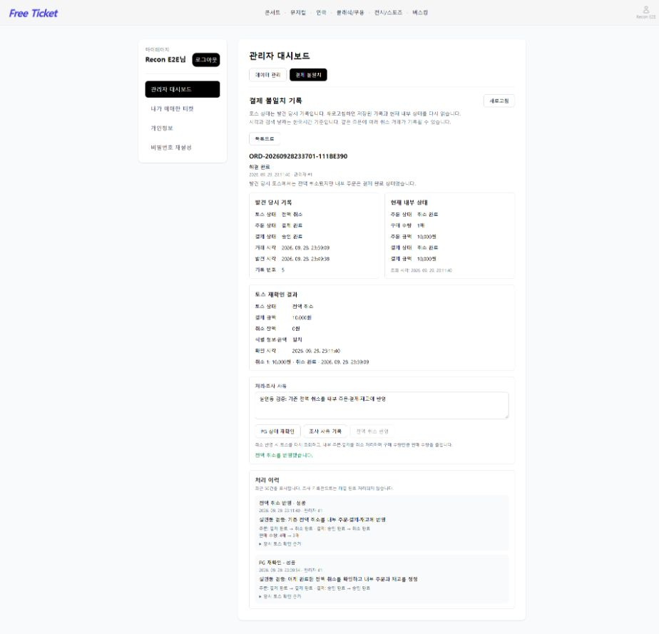
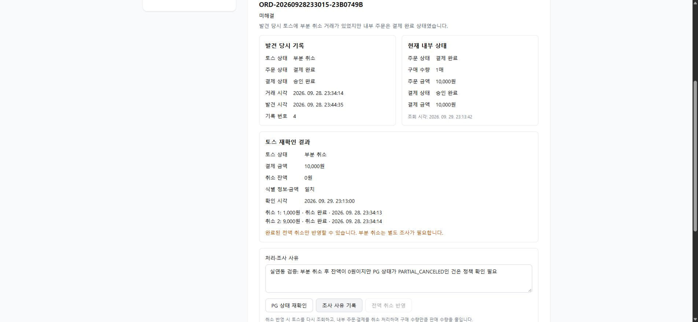

# 관리자 결제 불일치 처리 구현·검증 보고서

> 작성일 당시의 측정·검증 기록이다. 본문의 `artifacts/…` 경로에 있던 원시 데이터(CSV, 로그, 측정 스크립트)는 용량 때문에 저장소에 포함하지 않았고, 서버 주소는 `<EC2 주소>`로 가렸다.

작성일: 2026-09-29

## 구현한 기능

- 기존 관리자 대시보드의 결제 불일치 상세에서 PG 상태 재확인, 조사 사유 기록, 전액 취소 반영을 제공한다.
- 발견 당시 기록은 보존하고, 현재 내부 상태와 관리자가 확인한 PG 근거를 별도로 표시한다.
- 미해결/해결 완료 필터와 처리 이력을 제공한다. 상세 화면에는 최근 50건을 표시하며 과거 이력도 DB에 보존한다.
- 관리자 권한은 JWT 역할과 현재 users의 ADMIN·ACTIVE 상태를 모두 검사한다.
- 전액 취소 반영에는 주문번호, 구매 수량과 처리 사유를 확인하는 단계가 있다.

## 처리 조건과 데이터 보장

전액 취소 반영은 요청마다 실제 토스 조회를 다시 수행한다. 이전 재확인 결과만으로 처리하지 않는다.

다음을 확인한 경우에만 내부 상태를 변경한다.

1. PG의 현재 상태가 CANCELED이고 잔액이 0원이다.
2. 모든 취소 내역이 DONE이며 취소 금액 합계가 최초 결제 금액과 같다.
3. 주문번호, 결제 키, MID, KRW 통화와 내부 주문·결제 금액이 일치한다.
4. 주문 수량·단가와 총액이 일치하고 내부 주문/결제는 PAID/DONE 상태다.
5. 티켓과 공연 정보가 맞고 판매 수량을 구매 수량만큼 줄여도 유효하다.

외부 조회 중에는 DB 트랜잭션과 행 잠금을 유지하지 않는다. 반영 단계에서는 주문 → 불일치 기록 → 결제 → 티켓 순서로 잠근다.

주문 CANCELED, 결제 CANCELED, 판매 수량 감소, 해당 불일치 해결 시각·관리자, 성공 이력을 하나의 트랜잭션으로 저장한다.

재시도와 같은 주문의 다른 불일치 처리에서도 재고를 다시 반환하지 않는다. 내부 상태만 이미 CANCELED인 경우에는 재고 복구를 추정하지 않고 성공 처리 이력을 요구한다. 성공 이후 상태를 수동으로 PAID/DONE으로 되돌려도 다시 재고를 반환하지 않는다.

실패 시 정상화 변경은 롤백하고 실패 이력만 별도로 저장한다. 조회 근거, 처리 사유, 관리자 ID, 시각, 변경 전후 상태와 재고 수량을 기록한다. 실패 이력 저장까지 실패하면 별도 오류를 반환한다.

이 기능은 토스 취소 API를 호출하지 않는다. 이미 외부에서 완료된 전액 취소를 내부 데이터에 반영한다.

## API와 DB 변경

- GET `/api/admin/payment-reconciliation/issues`: 기존 검색 + `resolution=OPEN|RESOLVED`.
- GET `/api/admin/payment-reconciliation/issues/{id}`: 현재 내부 상태, 마지막 PG 확인 근거, 최근 처리 이력.
- POST `/api/admin/payment-reconciliation/issues/{id}/recheck`.
- POST `/api/admin/payment-reconciliation/issues/{id}/apply-full-cancellation`.
- POST `/api/admin/payment-reconciliation/issues/{id}/notes`.
- 모든 처리 요청은 `reason` 1~500자가 필요하다.
- SQL: `code/backend/db/2026-09-29-payment-reconciliation-actions.sql`.
- 기존 불일치 테이블에 해결 시각/관리자 컬럼을 추가하고 처리 이력 테이블을 추가했다. MID는 VARCHAR(14)를 유지했다.

## 자동 검증

- 백엔드 전체: 총 163건, 162건 통과, 실패/오류 0건, 기존 선택 실행 MySQL 동시 주문 테스트 1건 건너뜀.
- 새 관리자 처리 통합 검증 12건: PG 조회 중 트랜잭션 없음, 중복·동시 요청, 서로 다른 불일치의 같은 주문 처리, 오래된 재확인 결과, 부분 취소/잔액/금액/식별 정보 불일치, 조회 실패 이력, DB 저장 실패 롤백과 재시도, 수동 상태 초기화, 결제 누락·재고 부족, 외부 취소 시각 오류, 관리자 권한·처리 사유.
- 토스 HTTP 클라이언트: MID·통화·잔액·취소 내역 응답 파싱 검증 추가.
- 프론트엔드 전체 38건 통과. TypeScript/Vite 빌드와 변경 관리자 파일 ESLint 통과.
- Docker 이미지 안에서도 전체 테스트와 실행 파일 빌드가 통과했다.
- 독립 코드 리뷰에서 P1/P2 지적 없음. 취소 내역 DONE을 승인 완료로 표시하던 문구는 취소 완료로 수정했다.

## 실제 토스 테스트 연동 결과

기존 격리 DB `free_ticket_recon_e2e_20260928_84a308d1`에 보관된 본인 테스트 결제만 사용했다. 새 결제·PG 취소 요청은 수행하지 않았다.

### 전액 취소: ORD-20260928233701-111BE390

- Chrome 관리자 화면에서 실제 토스 결제 조회: CANCELED, 최초 금액 10,000원, 잔액 0원, 완료된 취소 10,000원.
- 재확인만 수행했을 때 판매 수량 4 유지.
- 관리자 확인 후 내부 주문/결제 PAID/DONE → CANCELED/CANCELED.
- 판매 수량 4 → 3, 불일치 기록 5 해결 완료, 관리자 1과 사유/근거/전후 상태 저장.
- 실제 API 반복 요청: NO_CHANGE, 판매 수량 3 유지.
- 해결 완료 검색으로 해당 기록 조회 가능.

### 부분 취소: ORD-20260928233015-23B0749B

- 실제 토스 조회: PARTIAL_CANCELED, 잔액 0원, 완료 취소 1,000원 + 9,000원.
- 전액 취소 반영 버튼 비활성화. API 직접 요청도 HTTP 409로 차단.
- 조사 사유 기록과 실패 이력 저장. 불일치 기록 4 미해결 유지.
- 내부 주문/결제는 PAID/DONE 유지, 공통 티켓 판매 수량 3 유지.

## 로컬 반영과 범위

- 현재 로컬 free_ticket DB에도 추가 SQL 적용, Docker 백엔드 8080 갱신, 스키마 validate와 정상 시작 확인.
- 사용자 DB의 주문·결제·재고·관리자 역할은 이번 실연동 처리로 변경하지 않았다. 처리는 격리 DB에서 수행했다.
- 테스트 계정은 격리 DB에서만 ADMIN으로 변경했다.
- 테스트 서버 18081/5174는 검증 후 종료하고 테스트 DB와 증거는 보존한다.
- 테스트 로그인을 기존 환경과 같은 localhost에서 수행하여 브라우저 로그인 쿠키가 공유됐다. 기존 계정은 다시 로그인해야 한다. 다음 검증용 실행 스크립트는 127.0.0.1을 사용하도록 바꿨다.
- 부분 취소 수량/환불 정책과 정보 불일치 자동 정정은 구현 범위 밖이다. 해당 건은 조사 기록을 남기고 미해결로 유지한다.
- H2 동시 처리 검증과 MySQL 실연동 재시도 검증을 수행했다. 실제 MySQL에서 관리자 동시 요청 부하 검증을 수행했다고 주장하지 않는다.
- (작성 당시) 코드 변경은 로컬 미커밋 상태였고 보고서와 화면 캡처는 Git 제외 디렉터리에 있었다. 이후 코드는 main에 반영됐고, 이 보고서와 캡처는 docs로 옮겼다.

## 화면 증거

- 
- 
